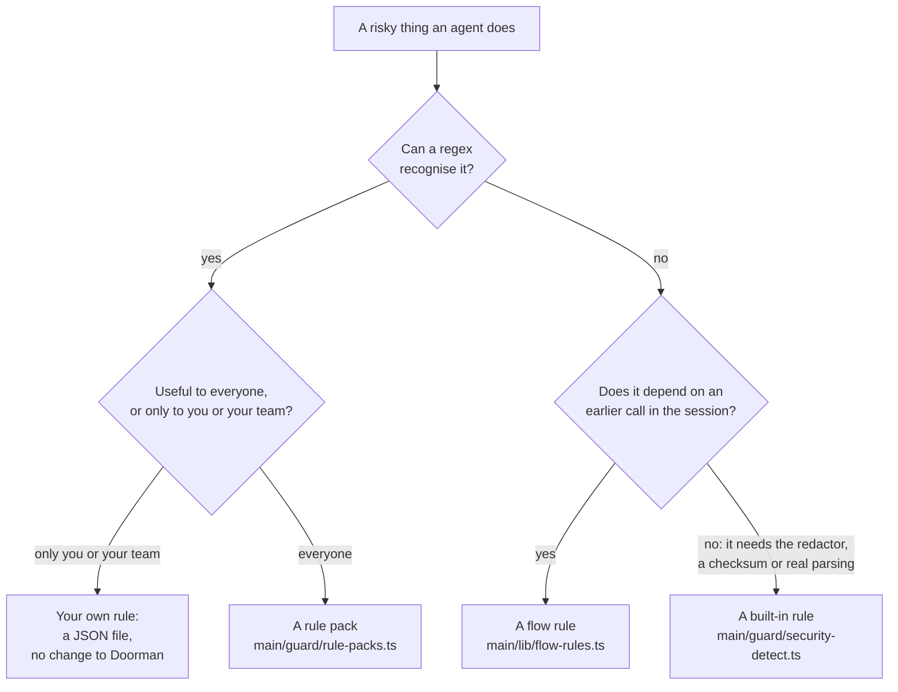

# Contributing to Doorman

Thanks for helping. This guide covers setting up, what a change needs before
it lands, and the most common contribution: teaching Doorman a new risk, as a
**rule pack** or a **built-in rule**. What rules, modes and packs are is
explained in [docs/rules.md](docs/rules.md); read that first.

## Set up

Doorman is an Electron app and a CLI built from the same TypeScript, on Node 22
(`.nvmrc`).

```sh
npm install
npm run dev          # compile and launch the app
npm run typecheck    # main process and tests
npm test             # vitest, the whole suite
npm run dev:sandbox  # a throwaway home and profile, safe to install the guard into
```

[Develop](README.md#develop) in the README has the rest, including how to keep
a development run away from your real agent configs (`DOORMAN_APPDATA_DIR`).

## What every change needs

- **Tests for the behaviour you changed.** A rule needs examples it must catch
  and close neighbours it must not (see below). Run the files you touched
  with `npx vitest run <file>`, then `npm test` once before you open the pull
  request.
- **A line in [CHANGELOG.md](CHANGELOG.md)** under `## Unreleased`, if people
  using Doorman will notice the change: what changed for them, in one
  sentence, under `### New`, `### Changed` or `### Fixed`.
- **No real secrets in fixtures.** Use obviously fake values; the repository
  is public.

Open a pull request against `main` on
[PinataCloud/doorman](https://github.com/PinataCloud/doorman).

## Teaching Doorman a new risk

First decide where the detection belongs. Most new risks are patterns over
what a call is, and those go in a pack.



### Add a rule pack

A pack is a list of rules in the [custom rule format](docs/rules.md#fields),
so a pack can only hold rules that fit a `when` clause. Packs live in
`SHIPPED_RULE_PACKS` in [`main/guard/rule-packs.ts`](main/guard/rule-packs.ts).

1. **Add the pack:**

   ```ts
   {
     id: "cloud_deletes",
     label: "Cloud resources deleted",
     blurb: "Deleting buckets, databases and clusters from the command line. Held for a keystroke, the way a terraform destroy is.",
     default_on: false,
     rules: [
       {
         id: "s3_bucket_removed",
         label: "S3 bucket removed",
         severity: "high",
         mode: "ask",
         when: { command: "(?:^|\\s)aws\\s+s3\\s+rb\\b" },
       },
     ],
   },
   ```

   - **Ids:** lowercase, `-` or `_`. In findings a rule is
     `custom:<pack>--<rule>`, so rename nothing once it has shipped: renaming
     orphans people's history and their edited copies.
   - **`label`** is what people see on a held call; say what happened
     ("S3 bucket removed"), not the pattern.
   - **`blurb`** says what the pack catches and why its rules sit at the mode
     they do. Say what doesn't fire if that isn't obvious (local nodes,
     testnets, dry runs).
   - **Prefer `command`** for shell commands; it works whatever an agent calls
     its shell tool. Anchor verbs as `(?:^|\s)tool\s+verb\b`, so `npm run
     publish-docs` doesn't look like `npm publish`.

2. **Choose the modes.** Pick the quietest mode that is still useful, because
   every `ask` interrupts someone:
   - `ask` for irreversible, outward-facing actions: money moved, a key
     exported, production deleted;
   - `warn` or `observe` for "worth knowing", such as touching a live chain,
     using an exchange API or running as root.

   Nothing in Doorman ships on `block`.

3. **Choose `default_on`.** Off unless the pack is quiet on an ordinary
   developer machine and its holds are almost always worth it. People can turn
   on any pack in Guardrails or with `doorman packs enable <id>`.

4. **Make it visible.** A pack is shown unless its id is in
   `HIDDEN_RULE_PACKS` in
   [`main/guard/rule-scope.ts`](main/guard/rule-scope.ts).
   `test/rule-scope.test.ts` pins the list of shown packs, so update it there
   too.

5. **Test it** in [`test/custom-rules.test.ts`](test/custom-rules.test.ts),
   next to the existing pack tests. Every shipped pack rule is already checked
   to validate. Add a test that the patterns fire on what they target and stay
   quiet on their neighbours:

   ```ts
   it("cloud deletes pack fires on deletes and stays quiet on reads", () => {
     const rules = packRules(["cloud_deletes"], SHIPPED_RULE_PACKS);
     const fires = (command: string) => matchCustomRules(rules, input({ command, tool_input: { command } })).map((f) => f.detector);
     expect(fires("aws s3 rb s3://acme-logs --force")).toEqual(["custom:cloud_deletes--s3_bucket_removed"]);
     expect(fires("aws s3 ls s3://acme-logs")).toEqual([]);
     expect(fires("echo 'aws s3 rb is dangerous' >> notes.md")).toEqual([]);
   });
   ```

   The neighbours matter most: a pattern that holds a harmless command teaches
   people to click Allow without reading.

6. **Try it on real history** before you open the pull request. Copy the rule
   into a file, without the pack prefix, and run
   `doorman custom-rules dry-run rule.json --days 30` against your own
   transcripts. If it matches far more than you expected, narrow it.

A new pack reaches people with the next Doorman release.

Two constraints apply to everything in `main/guard/`. The directory is copied
as-is into Doorman's data directory and run by each agent's hook with plain
`node`, so nothing there may import from outside `main/guard/`. And pack
patterns must pass the same safety checks as anyone's own rules: no nested
repetition, nothing that matches empty text, at most 400 characters.

### Add a pattern to an existing pack

Add the rule to the pack's `rules`, extend that pack's fire-and-stay-quiet test
with the new commands, and add a CHANGELOG line. Changing an existing rule's
pattern is fine. Changing its `id` isn't (see above).

### Add a built-in rule

Built-in rules are for what a regex can't do: recognising secrets with the
redactor, checksum-verified wallet addresses, parsing a command properly. They
take more wiring, because each one gets a mode on every security level and a
place in the app:

| Step | Where |
|---|---|
| The detector itself, and its id in `SecurityDetectorId` | `main/guard/security-detect.ts` |
| Its id in `SHIPPED_DETECTORS` and its label in `DETECTOR_LABELS` | `main/guard/policy.ts` |
| Its mode on each level, as a `LEVEL_LADDER` row (without one it observes at every level) | `main/guard/policy.ts` |
| Its family on the Guardrails screen, in `RULE_FAMILIES` | `renderer/components.jsx` |
| What it means and how to fix it, in `DETECTOR_GUIDANCE` | `main/lib/ai-guidance.ts` |
| Whether the app shows it | `main/guard/rule-scope.ts` |

Test it with examples it must catch and close neighbours it must not (the
tests that call `detectSecurityFindings` show the pattern), then run
`test/radar-parity.test.ts` and `test/rule-scope.test.ts`, which check that
every rule is wired the same way everywhere. `npm run compile && npm run probe`
drives the whole catalog through the shipped guard.

### Add a flow rule

A flow rule pairs a **taint** (something an earlier call did, such as reading a
secret) with a **sink** (a later call that makes it dangerous, such as a network
send). It is a row in the `FLOW_RULES` table in
[`main/lib/flow-rules.ts`](main/lib/flow-rules.ts), plus the code that
recognises its taint and sink. Flow rules are judged on the Radar from
transcripts, so they record findings rather than hold calls. Tests go in
`test/flow-rules*.test.ts`.

## Sharing rules without changing Doorman

Rules that matter only to you or your team don't need a pull request. Write
them as a JSON list, keep the file in your team's repository, and have each
person run:

```sh
doorman custom-rules add team-rules.json --replace
```

`--replace` updates rules someone already has. [docs/rules.md](docs/rules.md)
covers the format, with examples.
