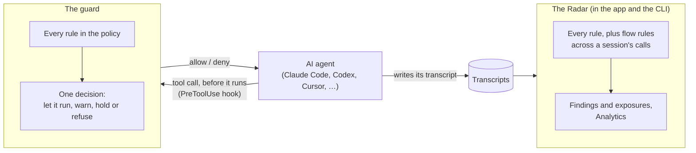
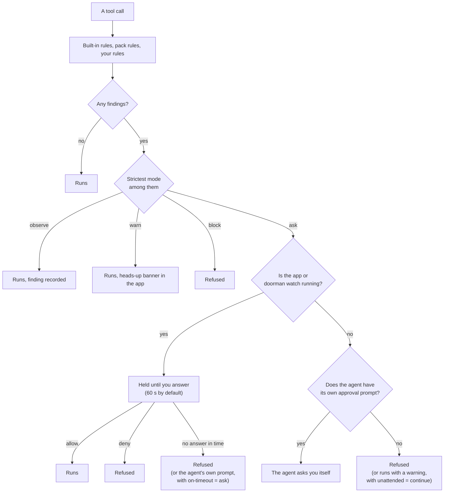
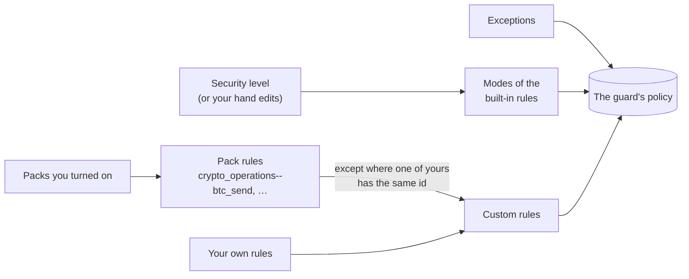
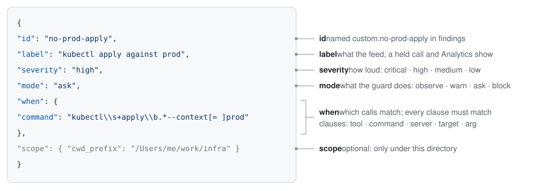
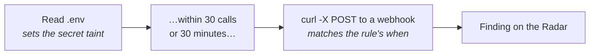

# Rules, packs and your own rules

Doorman decides what to do about an AI agent's tool call with **rules**. This
guide explains what a rule is, how Doorman picks one outcome when several
rules match, what a **rule pack** is, and how to write **your own rules**. To
add a rule or a pack to Doorman itself, see
[CONTRIBUTING.md](../CONTRIBUTING.md).

- [What a rule is](#what-a-rule-is)
- [Where rules run](#where-rules-run)
- [Modes: what happens to a call](#modes-what-happens-to-a-call)
- [What Doorman holds whatever the rules say](#what-doorman-holds-whatever-the-rules-say)
- [Severity: how loud a finding is](#severity-how-loud-a-finding-is)
- [Security levels](#security-levels)
- [The built-in rules](#the-built-in-rules)
- [Rule packs](#rule-packs)
- [Exceptions](#exceptions)
- [Your own rules](#your-own-rules)
- [Where it is all stored](#where-it-is-all-stored)

## What a rule is

A rule is one thing to look for (a detector) plus two settings:

| Part | What it is | Example |
|---|---|---|
| **Detector** | What the rule matches in a prompt, a tool call or a tool's output | A private key in a `curl` upload |
| **Mode** | What the guard does when it matches: **observe**, **warn**, **ask** or **block** | `ask`: hold the call until you answer |
| **Severity** | How loud the finding is: **critical**, **high**, **medium** or **low** | `high` |

There are three kinds of rules, and they all work the same way once they are
in your policy:

| Kind | Who writes it | Id in findings and exports |
|---|---|---|
| **Built-in rules** | Doorman, in code | `secret_egress` |
| **Pack rules** | Doorman, in the custom rule format, switched on per machine | `custom:crypto_operations--btc_send` |
| **Your own rules** | You, in the app or as a JSON file | `custom:no-prod-apply` |

## Where rules run

Rules run in two places: in the **guard**, before a tool call runs, and on the
**Radar**, over the agents' transcripts after the fact (past sessions
included).



The guard sees one call at a time. The Radar sees a whole session in order,
so it can also judge **flows**: something that happened earlier in a session
followed by a call that makes it dangerous, such as a secret read and then
an upload. A flow rule records a finding on the Radar; with one exception
(see [`after`](#after-only-after-something-earlier)), it can't stop the call.

## Modes: what happens to a call

| Mode | In the app | What happens |
|---|---|---|
| `observe` | OBS | The finding is recorded and the call runs. |
| `warn` | WARN | The call runs, and the app shows a heads-up banner. The agent is not told. |
| `ask` | ASK | The call is held until you answer allow or deny, in the app, the floating panel, a notification, VS Code or `doorman watch`. |
| `block` | BLOCK | The call is refused without asking. |

A rule can also be turned off entirely (`doorman rules disable <rule>`).

### One call, several rules

When several rules match one call, the strictest mode wins:
**block > ask > warn > observe**. The reason shown to you and to the agent
names every rule that drove the decision.



The hold settings are in the app under Guardrails, or with
`doorman policy confirm`:

| Setting | Default | Choices |
|---|---|---|
| `--hold` | 60 seconds | 10–300 (the app offers 30, 60, 120, 300) |
| `--on-timeout` | `deny` | `deny`, or `ask` to hand the call to the agent's own prompt |
| `--unattended` | `deny` | `deny`, or `continue` to let the call run with a warning |
| `--interactive` | `on` | `off` never holds; every ask goes the unattended way |

Agents with their own approval prompt are Claude Code, Cursor, Copilot, Droid,
Qwen and Grok. The others (Codex, Gemini CLI, Crush, Goose, Kimi, Kiro,
OpenCode, and usually Hermes and OpenClaw) can't ask you themselves, so an
unanswered ask follows the `--unattended` setting.

### What Doorman holds whatever the rules say

A few calls are held for you at every security level, whatever each rule's
mode, because they would let an agent stand down the check it is under:

- **Changes to Doorman's own files:** its guard, the guard's policy and
  answers, and the rest of Doorman's data directory, including your settings
  in `prefs.json`. Reading them is fine.
- **Doorman's own controls, run by the agent:** commands that turn protection
  down (`doorman guard uninstall`, `rules set`/`disable`, `policy level`,
  `policy confirm`, `packs disable`, `exceptions add`, `custom-rules add`,
  `remove` or `accept`), answer held calls (`doorman watch` in any form,
  `doorman sbx watch`), or hide what Doorman recorded (closing a finding,
  `config set retention_days`, `confidence_bands` or `show_false_positives`,
  `model remove`, `mcp recognize`, `gateway unroute`). That covers `doorman`
  however it is run: by path, through `npx @pinata/doorman`, or through
  `node …/cli/index.js`.

Everything that only reads, tightens or suggests stays free, such as
`doorman status`, `scan`, `findings`, `rules enable`, `packs enable` and
`custom-rules dry-run`. An agent that wants a new rule suggests it instead
(see [Rules your agent suggests](#rules-your-agent-suggests)). If you do want
an agent to run one of these commands, allow it on the approval card, or run it
yourself.

## Severity: how loud a finding is

Severity never changes what happens to a call; only the mode does. Severity
ranks findings: the approval card, the Radar's counts, Analytics and the
notification threshold all read it.

| Severity | Use it for |
|---|---|
| `critical` | Act now: a key or seed phrase leaving the machine |
| `high` | Money moved, production changed, a secret in a risky place |
| `medium` | Worth a look: a credential file read, a publish |
| `low` | A record: something that happened, not a problem by itself |

## Security levels

A security level sets the mode of every built-in rule at once. It doesn't
touch packs, your own rules, exceptions or the hold settings.

| Rule | Relaxed | Watchful | **Balanced** (default) | Locked down |
|---|---|---|---|---|
| Credential in prompt, Credential in tool argument, Secret egress over the network, Wallet key material | observe | warn | **ask** | block |
| Personal data exposed | observe | warn | **ask** | ask |
| Environment dump, Credential file read, Hardcoded credential, Unrecognized secret, Secret manager read | observe | observe | **warn** | ask |
| Wallet address exposed | observe | observe | **warn** | warn |

Change one rule's mode by hand (in the app, or
`doorman rules set <rule> <mode>`) and the level shows as **Custom**. Moving
the level again overwrites hand-made changes, so the app offers to keep them
first as a **saved rule set**: a named copy of every rule's mode and which
packs are on, which you can restore later.

## The built-in rules

Built-in rules are written in code, because they need more than a pattern:
the redactor that recognises secrets, checksum-verified wallet addresses, or
the flow engine.

| Family | Rule | Default (Balanced) |
|---|---|---|
| Credentials & secrets | Credential in prompt | ask |
| | Credential in tool argument | ask |
| | Secret egress over the network | ask |
| | Environment dump | warn |
| | Credential file read | warn |
| | Hardcoded credential | warn |
| | Unrecognized secret | warn |
| | Secret manager read | warn |
| | Secret read, then network egress (session flow) | Radar only |
| Crypto wallets & keys | Wallet key material | ask |
| | Wallet address exposed | warn |
| | Wallet address from outside, then written or paid to (session flow) | Radar only |
| Personal data | Personal data exposed | ask |

`doorman rules` lists them with their current modes. Doorman has more rule
families (infrastructure and destructive commands, code and agent config,
exfiltration and hidden content, MCP servers, licensing, guard integrity) that
this build doesn't show; their rules never warn, hold or block.

## Rule packs

A **rule pack** is a named set of rules written in the same format as
[your own rules](#your-own-rules), shipped with Doorman and switched on or off
per machine. Packs add detections that are just patterns (a command, a tool,
an argument), so each pack rule is also a worked example you can read and copy.

Turning a pack on puts its rules into your policy, each under the id
`<pack>--<rule>`. Its findings show under the rule's own label.



### The packs in this build

**Crypto wallets: transfers, key exports, exchange APIs** (`crypto_operations`,
on by default) covers commands that move funds or export wallet keys:

| Rule | Severity | Mode |
|---|---|---|
| Bitcoin sent from a node wallet | high | ask |
| Bitcoin wallet keys exported | critical | ask |
| EVM transaction sent with cast | high | ask |
| Forge script broadcast | high | ask |
| EVM deploy or raw transaction on a live network | high | ask |
| Signer key or mnemonic on the command line | critical | ask |
| Solana transfer | high | ask |
| Solana keypair recovered or generated | high | ask |
| Sui / Aptos / NEAR / Cosmos transfer | high | ask |
| Exchange API called | medium | observe |
| Mainnet RPC endpoint called | low | observe |
| ENS name written | low | observe |

Local nodes and named testnets (localhost, anvil, sepolia, devnet, …) don't
fire. The checksum-verified address and seed-phrase checks are built-in rules
in the Crypto wallets & keys family; this pack is the command-shaped half.

### Turning packs on and off, and changing a pack rule

- **App:** Guardrails → Advanced → Rule packs, one switch per pack.
- **CLI:** `doorman packs`, `doorman packs enable <pack>`,
  `doorman packs disable <pack>`.
- **Change a pack rule:** set its mode in Guardrails → Advanced → Your rules,
  where pack rules are marked "from pack". That saves your own copy under the
  same id, which replaces the shipped one. `doorman custom-rules add file.json
  --replace` with the same id does the same from the terminal.

Packs ship with Doorman: a new or changed pack arrives with a Doorman update.

## Exceptions

An **exception** tells a built-in rule to ignore something: a test key that
isn't a secret, or a command that is safe in one project. An exception has a
pattern (a case-insensitive regex tested against the rule's name, the tool, its
target and the masked excerpt), and can be limited to one rule, one directory
or until a date.

"Allow for this project" on the approval panel writes one for you, limited to
that project's directory.

Exceptions apply to built-in rules. To narrow a pack rule or your own rule,
change its patterns or give it a `scope`.

## Your own rules

Your own rules let you hold, warn about or record calls Doorman doesn't know
are risky for you: `kubectl apply` against production, a message sent to
someone outside your company, a write to your Terraform state. A rule is
regular expressions over what a call is; no code runs.



### Writing one

- **In the app:** Guardrails → Advanced → Your rules → New rule. Five steps:
  name it, choose which calls it matches, optionally only in some situations,
  choose what the guard does, and review it with a dry run over your last 14
  days.
- **From the terminal:** write the rule (or a list of rules) in a JSON file,
  then:

  ```sh
  doorman custom-rules dry-run rule.json   # what it would have caught
  doorman custom-rules add rule.json       # save it
  doorman custom-rules                     # your rules, and the ones packs add
  doorman custom-rules remove no-prod-apply
  ```

A saved rule applies from the agent's next tool call.

### Fields

| Field | Required | What it is |
|---|---|---|
| `id` | yes | 1–48 lowercase letters, digits, `-` or `_`, starting with a letter or digit. Findings name it `custom:<id>`, so it can never clash with a built-in rule. |
| `label` | yes | What the feed, a held call and Analytics call it (up to 80 characters). |
| `blurb` | no | One sentence on why it matters (up to 240 characters). |
| `severity` | yes | `critical`, `high`, `medium` or `low`. |
| `mode` | yes | `observe`, `warn`, `ask` or `block`. |
| `when` | yes | Which calls it matches; at least one clause (below). |
| `after` | no | Only after something earlier in the session: `{ "taint": "<kind>" }`. |
| `scope` | no | Only under one directory: `{ "cwd_prefix": "/Users/me/work/infra" }`. |
| `enabled` | no | `false` keeps the rule but switches it off. |

### `when`: which calls it matches

Every clause you write must match; leave one out to match more calls.

| Clause | Matched against |
|---|---|
| `tool` | The tool name. The guard gives most agents' common tools Claude Code's names: `Bash`, `Write`, `Edit`, `Read`, `WebFetch`. Transcripts on the Radar keep some agents' own names (Codex's shell is `shell`), so a rule meant for both lists them: `^(?:Bash\|shell)$`. MCP tools are `mcp__<server>__<tool>`. |
| `command` | The shell command of a shell call, **with secrets already masked**: a rule can never be used to probe for a secret's value. |
| `server` | The MCP server in `mcp__<server>__<tool>`. |
| `target` | The program a shell command runs (`kubectl`), or the file a tool reads or writes. |
| `arg` | Named fields of the tool's input: `{ "to": "…", "params.channel": "…" }`. Dotted paths reach nested fields; numbers and lists are matched as text. A field that is missing doesn't match. |

For shell commands, prefer `command` over `tool`: it works whatever the agent
calls its shell tool.

### How patterns behave

- Patterns are JavaScript regular expressions and are **case-insensitive**.
  They match anywhere in the text unless you anchor them with `^` or `$`.
- In JSON, a backslash is written twice: `\\s+` in the file is `\s+` in the
  pattern.
- Doorman refuses patterns that could hang the guard or match everything, and
  then refuses the whole rule rather than keeping it half-checked:
  - longer than 400 characters;
  - nested repetition such as `(a+)+` or `(.*)*`;
  - a pattern that matches empty text, such as `.*` or `x?`.
- Each text a pattern is tested against is cut at 64,000 characters.
- You can have up to 64 rules of your own.
- An excerpt of what matched is stored with the finding, masked and at most 200
  characters.

### `after`: only after something earlier

`after` makes a **flow rule**: the call in `when` fires only if something of
the named kind happened earlier in the same session, within the last 30 calls
or 30 minutes.

| `taint` | Set when the agent… |
|---|---|
| `secret` | reads a secrets file (`.env`, `~/.aws/credentials`, a key file), dumps the environment or reads a secret manager |
| `injection` | gets tool output containing a prompt-injection marker |
| `untrusted_fetch` | downloads something runnable (`curl -o x.sh`, a script URL) |
| `private_data` | reads from a mail, chat, docs or tracker MCP server |
| `sql_result` | runs a database client or an MCP database query |



Flow rules are judged on the Radar, from transcripts, so they record findings
but can't hold the call (the app shows them as "radar only"). The exception is
`after: injection` with mode `ask` or `block`: after an injection marker, the
guard holds or refuses the next call that matches `when`. This is best effort,
since it depends on the app reading the transcript in time.

### Examples

Hold `kubectl apply` against the production context:

```json
{
  "id": "no-prod-apply",
  "label": "kubectl apply against prod",
  "severity": "high",
  "mode": "ask",
  "when": { "command": "kubectl\\s+apply\\b.*--context[= ]prod" }
}
```

Ask before a Slack message goes to a channel outside an allow-list:

```json
{
  "id": "slack-outside",
  "label": "Slack message outside #eng",
  "severity": "medium",
  "mode": "ask",
  "when": { "tool": "^mcp__slack__", "arg": { "channel": "^(?!#?eng$)\\S" } }
}
```

Warn when an agent edits Terraform state, only in the infra repo:

```json
{
  "id": "tfstate-write",
  "label": "Terraform state edited",
  "severity": "high",
  "mode": "warn",
  "when": { "tool": "^(?:Write|Edit|MultiEdit)$", "target": "\\.tfstate$" },
  "scope": { "cwd_prefix": "/Users/me/work/infra" }
}
```

Refuse a shell command right after a prompt injection was seen:

```json
{
  "id": "shell-after-injection",
  "label": "Shell command after a prompt injection",
  "severity": "critical",
  "mode": "block",
  "when": { "tool": "^(?:Bash|shell)$" },
  "after": { "taint": "injection" }
}
```

Record database dumps leaving through `curl` (Radar only):

```json
{
  "id": "sql-then-upload",
  "label": "Query results uploaded",
  "severity": "high",
  "mode": "observe",
  "when": { "command": "curl\\b.*(?:--data|-d|-F|--upload-file)\\b" },
  "after": { "taint": "sql_result" }
}
```

A file can hold one rule or a list (`[ {…}, {…} ]`). Share a list with your
team as a file; `doorman custom-rules add team-rules.json` adds them, and
`--replace` updates rules you already have.

### Dry run

A dry run checks a rule against the transcripts of your last 14 days (1–90
with `--days`) and reports how many calls and sessions it would have matched,
with a few examples. It changes nothing, and saving doesn't require one. A rule
that matches hundreds of calls a day will hold you up all day: narrow it before
choosing `ask`.

### Rules your agent suggests

An agent can suggest a rule for you to review. It needs Doorman's own MCP
server: **Settings → Agents can ask Doorman** (or `doorman mcp server install`)
registers it with VS Code (Copilot agent mode) and Copilot CLI. Other agents
add it themselves; on macOS:

```sh
claude mcp add doorman -- node "$HOME/Library/Application Support/Doorman/doorman/mcp/doorman-mcp.js"
codex mcp add doorman -- node "$HOME/Library/Application Support/Doorman/doorman/mcp/doorman-mcp.js"
```

(The script is there once the setting is on; on Linux it is under
`~/.config/Doorman`, on Windows under `%APPDATA%\Doorman`.) Then ask, for
example: "propose a Doorman rule that holds kubectl apply against prod". The
agent writes the rule in the format above and sends it with a one-line reason.

The suggestion shows up in **Guardrails → Advanced → Your rules**, under
"Suggested by your agents" (Advanced opens on its own and counts them while any
are waiting), and the app says so when one arrives. **Review** opens it in the
rule editor on its last step, where you can change anything and dry run it;
saving adds it to your rules. **Dismiss** drops it. From the terminal,
`doorman custom-rules` lists suggestions with their ids,
`doorman custom-rules accept <id>` saves one and
`doorman custom-rules dismiss <id>` drops it.

Nothing applies until you save it. A suggestion can only add a new rule: one
that would change, switch off or replace a rule you already have (your own or a
pack's), or that reuses another suggestion's id, is refused. At most 20 wait at
once.

## Where it is all stored

Everything lives in Doorman's data directory, shared by the app and the CLI:

| OS | Data directory |
|---|---|
| macOS | `~/Library/Application Support/Doorman` |
| Linux | `$XDG_CONFIG_HOME/Doorman`, else `~/.config/Doorman` |
| Windows | `%APPDATA%\Doorman` |

`DOORMAN_APPDATA_DIR` overrides it.

- `prefs.json` keeps your choices: the level, each rule's mode, which packs are
  on, your own rules, exceptions and saved rule sets.
- `doorman/guard/policy.json` is what the guard reads: the same choices with
  the pack rules filled in. The app and the CLI rewrite it whenever something
  changes; editing it by hand is undone at the next change.
